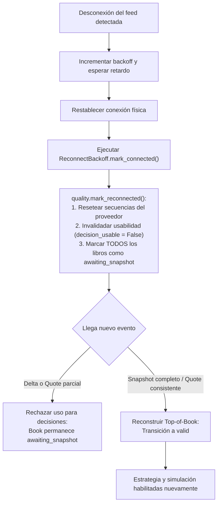

# Fase 9: observabilidad y despliegue

## Objetivo

Conocer en todo momento la salud del feed de datos y del motor de simulación, publicar telemetría estandarizada, registrar alertas de incidentes y recuperarse de interrupciones de red o degradaciones de calidad con absoluta seguridad operativa, garantizando que el motor **nunca asigne validez a un libro de órdenes que no la tiene** y manteniendo un diseño **estrictamente de simulación (sin ejecución real)**.

---

## 1. Métricas publicadas y convenciones OpenTelemetry

El motor genera un snapshot de telemetría fuera de banda (`ObservabilitySnapshot`) estructurado conforme a las [convenciones semánticas de OpenTelemetry](https://opentelemetry.io/docs/specs/semconv/). Las métricas se organizan en namespaces jerárquicos normalizados:

| Namespace / Métrica | Tipo | Descripción |
|---|---|---|
| `market.feed.connected.<provider_id>` | Gauge (0/1) | Estado de conexión del adaptador con el proveedor. |
| `market.feed.frames_received.<provider_id>` | Contador | Total de frames brutos recibidos desde el adaptador. |
| `market.feed.last_receive_age_ns.<provider_id>` | Gauge (ns) | Tiempo transcurrido desde el último frame recibido. |
| `market.feed.streams_stale.<provider_id>` | Gauge | Cantidad de streams marcados como obsoletos por política de calidad. |
| `market.feed.books_awaiting_snapshot.<provider_id>` | Gauge | Libros bloqueados esperando snapshot consistente tras gap o corte. |
| `market.feed.sequence_gaps` | Contador | Total acumulado de saltos de secuencia detectados. |
| `market.feed.duplicates` | Contador | Total de eventos duplicados detectados (por secuencia o huella). |
| `market.feed.stale_events` | Contador | Total de eventos rechazados por timestamp o silencio excesivo. |
| `market.engine.queue.pending.<queue>` | Gauge | Eventos encolados pendientes en cada etapa del motor. |
| `market.engine.queue.capacity.<queue>` | Gauge | Capacidad máxima configurada para el canal de la etapa. |
| `market.engine.queue.rejected.<queue>` | Contador | Eventos rechazados por saturación de cola (overflow). |
| `market.engine.queue.utilization.<queue>` | Gauge (0..1) | Fracción de ocupación de la cola respecto a su capacidad. |
| `market.engine.stage.duration_ns.count.<stage>` | Contador | Número de eventos procesados en cada etapa del pipeline. |
| `market.engine.stage.duration_ns.p99.<stage>` | Gauge (ns) | Latencia percentil 99 (límite superior log2) en la etapa. |
| `market.engine.events.processed` | Contador | Eventos de mercado procesados extremo a extremo. |
| `market.engine.orders` | Contador | Total de órdenes generadas por la estrategia en simulación. |
| `market.engine.fills` | Contador | Total de ejecuciones (fills) simuladas con auditoría L1. |
| `market.portfolio.version` | Gauge | Versión incremental del estado de cartera. |
| `market.portfolio.ledger_entries` | Contador | Total de asientos inmutables en el ledger contable. |
| `market.portfolio.realized_pnl.<currency>` | Gauge | P&L realizado en cada divisa base. |
| `market.portfolio.unrealized_pnl.<currency>` | Gauge | P&L no realizado valorado a precios mark-to-market. |
| `market.recording.records_written` | Contador | Registros persistidos con checksum en el journal de sesión. |
| `market.recording.records_dropped` | Contador | Registros descartados por el escritor en segundo plano. |
| `market.recording.queue.pending` | Gauge | Registros en cola pendientes de persistencia en disco. |
| `market.recording.complete` | Gauge (0/1) | 1 si la sesión se cerró y grabó íntegra; 0 ante fallos o descartes. |

---

## 2. Correlación de logs y protección del hot path

### Criterio de camino crítico sin I/O de logging por evento
El motor procesa eventos de alta frecuencia en memoria. **No se emiten llamadas de logging dentro del bucle de procesamiento crítico de eventos**. Las trazas e incidencias se generan exclusivamente:
1. En transiciones de estado de conexión y ciclo de vida de la sesión.
2. Fuera de banda mediante la emisión estructurada de alertas (`log_alerts`).
3. En fallos críticos que abortan el procesamiento de una etapa.

### Formateador estructurado (`JsonLogFormatter`)
Todos los logs se emiten en formato JSON de una sola línea conteniendo campos obligatorios y correlación contextual:
- `timestamp`: Marca de tiempo en UTC con formato ISO 8601.
- `severity`: Nivel en minúsculas (`info`, `warning`, `critical`, `error`).
- `logger`: Nombre del componente emisor.
- `message`: Descripción del evento.
- **Correlación de contexto**:
  - `session_id`: Identificador único de la sesión o simulación.
  - `instrument_id`: Identificador canónico del instrumento financiero.
  - `sequence`: Número de secuencia asignado por la fuente o el secuenciador.
  - `order_id`: Identificador de la orden simulada.
  - `stage`: Etapa del pipeline donde se produjo el evento.
  - `provider_id`: Proveedor de datos involucrado.
  - `event_code`: Código estandarizado de la anomalía o evento.

### Redacción estricta de credenciales
`JsonLogFormatter` aplica filtrado recursivo de campos sensibles:
- Toda clave que contenga `secret`, `password`, `token`, `api_key`, `apikey`, `credential` o `authorization` es sustituida automáticamente por `"[REDACTED]"`.
- Patrones dentro de cadenas de texto (como cabeceras `Authorization: Bearer <token>` o parámetros `api_key=...`) son redactados mediante expresiones regulares antes de su emisión.

---

## 3. Catálogo de alertas y políticas operativas

Las condiciones de alerta están centralizadas en `config/alerts.json` y se gestionan a través de la clase `AlertPolicy`:

```json
{
  "version": "1.0.0",
  "max_receive_silence_ns": 5000000000,
  "queue_utilization_threshold": "0.90",
  "quality_count_threshold": 1,
  "recording_required": false,
  "max_spread_by_instrument": {
    "XAUUSD": "1.50"
  }
}
```

### Matriz de alertas operativas

| Código de alerta | Severidad | Condición desencadenante |
|---|---|---|
| `feed_disconnected` | Critical | El adaptador de red reporta estado desconectado o desconocido. |
| `feed_no_data` | Warning | El adaptador figura conectado pero no ha recibido ningún frame de datos. |
| `feed_data_stale` | Warning | El tiempo de silencio desde la última recepción excede `max_receive_silence_ns`. |
| `feed_stale_stream` | Warning | Uno o más streams tienen calidad marcada como obsoleta por política temporal. |
| `book_awaiting_snapshot` | Critical | El libro de órdenes está bloqueado esperando snapshot consistente; decisiones detenidas. |
| `feed_sequence_gap` | Warning | Se detecta un salto en la secuencia de paquetes (`sequence_gap >= threshold`). |
| `feed_duplicate` | Warning | Detección de mensajes o huellas duplicadas (`duplicate >= threshold`). |
| `engine_queue_saturated` | Critical / Warning | La ocupación de alguna cola supera el umbral (warning) o descarta eventos (critical). |
| `recording_incomplete` | Critical | El grabador en segundo plano descartó registros o experimentó error de E/S. |
| `recording_missing` | Critical | La política exige grabación de sesión y no se configuró ningún grabador. |
| `spread_anomalous` | Warning | El spread bid/ask observado supera el umbral fijado en `max_spread_by_instrument`. |
| `replay_divergence` | Critical | Una corrida de replay determinista arroja diferencias frente a la sesión original. |

---

## 4. Manual de recuperación ante interrupciones

### Política de reconexión con backoff configurable (`ReconnectBackoff`)
Ante cortes en la capa de transporte, el sistema utiliza un backoff exponencial acotado con jitter determinista para evitar tormentas de reconexión:
- `initial_delay_seconds`: Retardo inicial (ej. 0.5 s).
- `multiplier`: Factor multiplicador exponencial (ej. 2.0).
- `maximum_delay_seconds`: Límite superior de espera (ej. 30.0 s).
- `jitter_fraction`: Rango aleatorio de fluctuación, alimentado con semilla (`seed`) reproducible.

### Protocolo de invalidación y reconstrucción del libro
El riesgo crítico de una reconexión es operar sobre un libro de órdenes desactualizado o inconsistente. Por diseño, el motor aplica la siguiente secuencia fail-closed:



1. **Invalidación inmediata**: Al llamar a `mark_connected`, el monitor de calidad borra los estados de secuencia anteriores y marca todos los libros asociados a ese proveedor como `awaiting_snapshot`.
2. **Bloqueo de decisiones**: Ningún intent de orden ni decisión de estrategia puede ejecutarse mientras el libro esté en `awaiting_snapshot`. Si llega un trade o delta antes de un snapshot, la decisión es bloqueada y se emite un diagnóstico de calidad.
3. **Reconstrucción determinista**: Solo la recepción de un snapshot completo con profundidad válida (o un quote L1 consistente) restablece el estado del libro a `valid` y permite reanudar las decisiones.
4. **Validación de grabaciones de sesión**:
   Tras una interrupción, cualquier sesión grabada puede verificarse con:
   ```console
   python -m market_catalog verify-session ruta/a/sesion
   ```
   Si la sesión contiene segmentos incompletos o descartes, el manifest marcará la sesión como no íntegra y se prohibirá su uso como base de replay.

---

## 5. Perfil de despliegue y aislamiento de seguridad

El perfil de despliegue (`config/deployment.profile.json`) se valida de forma fail-closed contra [`schemas/deployment_profile.schema.json`](../schemas/deployment_profile.schema.json) y el validador en [`src/market_catalog/deployment.py`](../src/market_catalog/deployment.py).

### Restricciones inmutables de seguridad
1. **Prohibición absoluta de trading real**:
   - `live_execution_enabled`: Debe ser estrictamente `false`.
   - `execution_adapter`: Debe ser estrictamente `null`. El código no contiene adaptadores hacia brokers ni APIs de enrutamiento real.
2. **Aislamiento de red saliente**:
   - `outbound_network.default_policy`: Debe ser `"deny"`.
   - `outbound_network.allowed_hosts`: Lista explícita y exhaustiva de nombres de host o IPs correspondientes a proveedores de datos de mercado autorizados. Se prohíben comodines (`*`), URLs con protocolos y rutas relativas.
3. **Credenciales y privilegios mínimos**:
   - `credentials.source`: Debe apuntar a un gestor de secretos externo seguro (ej. HashiCorp Vault, AWS Secrets Manager).
   - `credentials.secrets_in_config`: Debe ser `false`. Queda prohibido almacenar credenciales en archivos locales o de configuración.
   - `credentials.redact_from_logs`: Debe ser `true`.
   - `credentials.permissions`: Todos los alcances deben terminar obligatoriamente en `.read` (ej. `market_data.read`, `catalog.read`). Cualquier término vinculado a trading (`trade`, `trading`, `orders.write`, `order_entry`, `execution`, `brokerage`) provoca el rechazo inmediato del perfil de despliegue.

### Comandos CLI de verificación

Para validar el perfil de despliegue:
```console
python -m market_catalog validate-deployment config/deployment.profile.json
```

Para validar la política de alertas:
```console
python -m market_catalog validate-alerts config/alerts.json
```

---

## 6. Paneles de visualización (`observability/dashboard.json`)

El archivo [`observability/dashboard.json`](../observability/dashboard.json) define la disposición de paneles para consolas de observabilidad (Grafana / OpenTelemetry Collector):

1. **Conexión y recepción**: Conectividad por proveedor, frames recibidos, antigüedad del último frame (`last_receive_age_ns`), streams obsoletos y libros en espera de snapshot.
2. **Calidad del feed**: Saltos de secuencia (`sequence_gaps`), eventos duplicados (`duplicates`) y eventos caducados (`stale_events`).
3. **Presión y saturación de colas**: Ocupación relativa (`utilization`), eventos rechazados por overflow (`rejected`), eventos en cola (`pending`) y capacidad máxima (`capacity`).
4. **Latencias de etapas**: Latencia p99 por etapa (`stage.duration_ns.p99`), conteo de operaciones y total procesado.
5. **Simulación, órdenes y P&L**: Fills simulados, órdenes generadas, P&L realizado y no realizado por divisa, versión de cartera y número de entradas en el ledger.
6. **Estado de grabación**: Registros escritos en disco, registros descartados por saturación, cola del escritor y estado de completitud de la sesión (`complete`).
